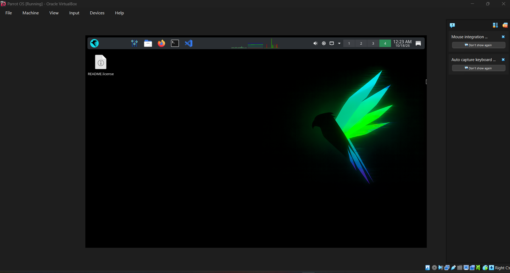

# Virtualization Lab

[← Back to index](../README.md)

Activity: creating and configuring a virtual machine.

## Objective
Create a working VM and understand its core settings.

## Environment
| Item | My setup |
|---|---|
| Hypervisor | Oracle VirtualBox |
| Guest OS | Parrot OS |
| VM name | Parrot OS |
| RAM / CPU / Disk | 4096 MB (4 GB) / 2 CPUs / 25 GB, dynamically allocated VDI |

## General procedure
1. Install the hypervisor.
2. Create a new VM and choose the guest OS ISO.
3. Allocate RAM, CPU cores, and disk space.
4. Choose the network mode (NAT, Bridged, Host-only).
5. Install the guest OS and take a snapshot.

## Network modes
- **NAT:** VM reaches the internet; hidden from the LAN.
- **Bridged:** VM appears as a separate device on the LAN.
- **Host-only:** VM talks only to the host (isolated lab).

## Screenshot

*Parrot OS booted and running inside Oracle VirtualBox (taken 10/18/26).*

## Observations
Parrot OS was installed and is running inside Oracle VirtualBox (see the screenshot above). During installation and startup, the VM returned to the Try/Install screen.

## Problems and fixes
| Problem | Fix |
|---|---|
| VM kept returning to the Try/Install screen | Troubleshot the configuration and checked the VM settings, installation media, and available disk space |

## My Reflection
During this activity, I learned how to use VirtualBox to install and run Parrot OS in a virtual machine. I encountered installation and startup problems, including returning to the Try/Install screen, so I had to troubleshoot the configuration and check the available disk space. This experience taught me to check the virtual machine settings, installation media, and storage before attempting another installation. I also learned that patience and careful troubleshooting are important when preparing a cybersecurity laboratory environment.
