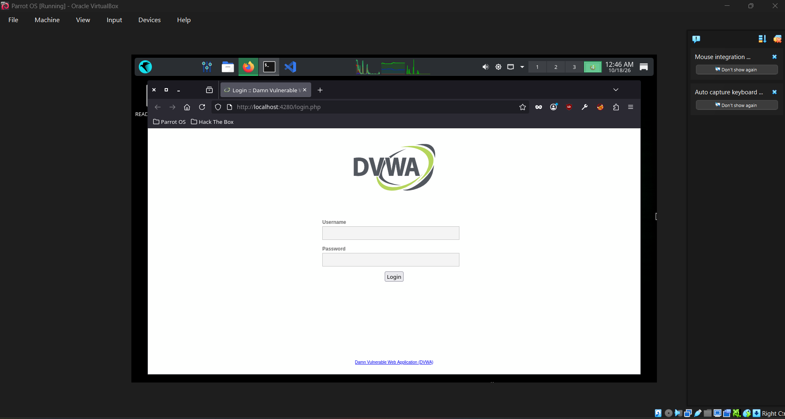
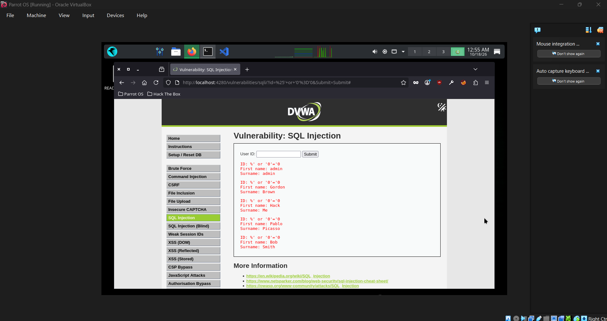

# DVWA Setup and Access Verification

[← Back to index](../README.md)

Lab: confirm that the DVWA environment works.

## Verification checklist
- [x] Web server is running
- [x] Database service is running
- [x] Database created and populated (user records are returned)
- [x] Login works
- [x] Security level set to Low
- [x] A vulnerability page (e.g., SQL Injection) loads

## Record
| Item | Result |
|---|---|
| Date | 2026-10-18 |
| Environment (VM/XAMPP/Docker) | Parrot OS VM in Oracle VirtualBox |
| URL used | http://localhost:4280/login.php |
| Security level tested | Low |

## Screenshots

*DVWA login page loading at localhost:4280 inside the Parrot OS VM.*

*After logging in, the SQL Injection vulnerability page loads, which confirms the database connection works.*

## My Reflection
I learned how to prepare a vulnerable web application environment for cybersecurity practice and verify whether it can be accessed through a browser. This activity helped me understand the importance of proper configuration before performing security tests. I also realized that checking the application and environment first can make troubleshooting easier. The experience gave me a better understanding of how security testing environments are prepared for laboratory exercises.
